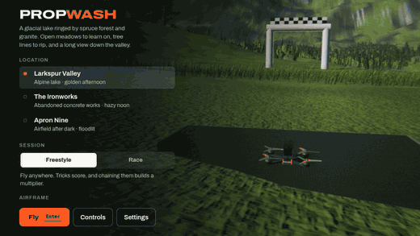
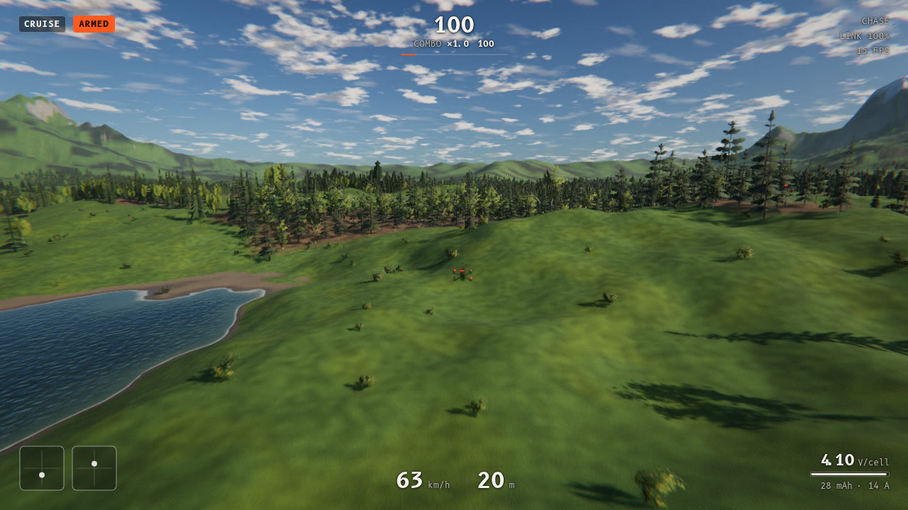
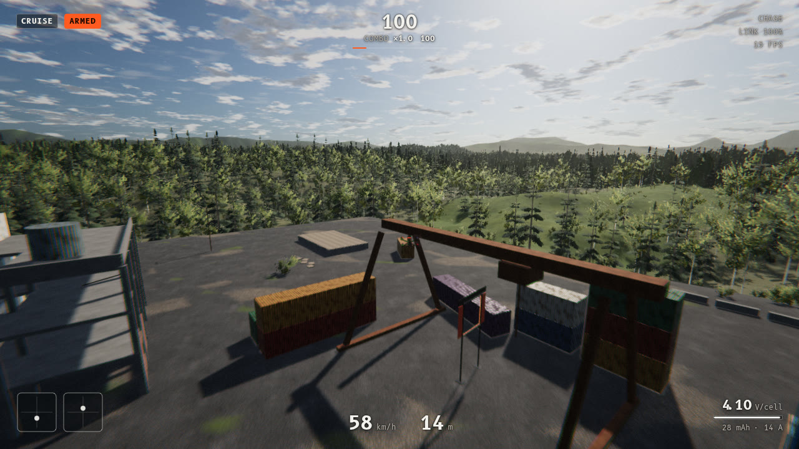
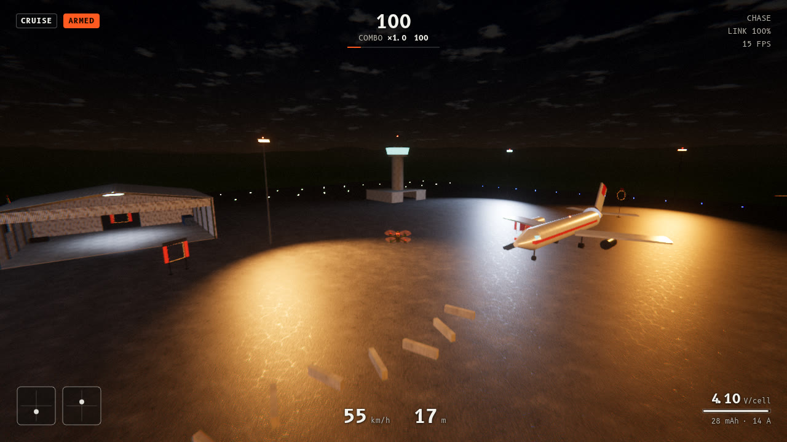

# Propwash

[](https://github.com/alexnieves-cs/propwash-fpv/actions/workflows/ci.yml)
[](LICENSE)



<sub>7.5 s of real flight captured from the running app in headless Chromium (software GL, Medium preset), one sim frame per GIF frame. [MP4](docs/media/hero.mp4).</sub>

**[Live demo](https://alexnieves-cs.github.io/propwash-fpv/)** · sibling projects: [frontier-fly](https://github.com/alexnieves-cs/frontier-fly), [drift-school](https://github.com/alexnieves-cs/drift-school)

An FPV drone simulator that runs in the browser. It models a real quadcopter — four motors, props, a battery and a Betaflight-style flight controller — and puts it in three hand-built worlds you can fly with nothing but a laptop keyboard.

*Prop wash* is the turbulent air a quad falls through when it descends into its own wake. It is simulated here, which is where the name comes from.

## Run it

The quickest way is the [live demo](https://alexnieves-cs.github.io/propwash-fpv/) (it downloads about 2 MB gzipped, most of it the Rapier physics engine). To run it locally you need [Node.js](https://nodejs.org) 20 or newer.

```bash
npm install
npm start
```

That opens the simulator at `http://127.0.0.1:5199`. On macOS you can also double-click `start.command`.

It needs a browser with WebGL 2 (current Chrome, Edge, Safari or Firefox). Everything — textures, models, sound — is generated at start-up, so there are no assets to download and it works offline after `npm install`.

## Flying

Two hands, two sticks, like a real radio in Mode 2.

| Keys | What they do |
| --- | --- |
| `W` `S` | Throttle: climb and descend. Let go and it settles at hover. |
| `A` `D` | Yaw left and right |
| `↑` `↓` | Pitch: nose down and nose up |
| `←` `→` | Roll left and right |
| `Shift` | Hold for fine control (less stick travel) |
| `Space` | Arm or disarm the motors |
| `R` | Reset to the pad, or to the last gate you cleared in a race |
| `T` | Turtle mode: flip back over after a crash |
| `1` `2` `3` `4` | Flight mode: Cruise, Angle, Horizon, Acro |
| `Q` `E` | Automatic roll left and right |
| `Z` `X` | Automatic front flip and backflip |
| `C` | Camera: FPV, chase, line of sight |
| `[` `]` | FPV camera tilt down and up |
| `-` `=` | Field of view narrower and wider |
| `M` | Use the trackpad as the right stick (pointer moves pitch and roll, click centres it) |
| `H` | Minimal HUD |
| `Backspace` | Restart the session |
| `Esc` | Pause |

A tap on a key is a small nudge; holding it pushes the virtual stick to full deflection. A gamepad or a USB radio is picked up automatically.

### Flight modes

- **Cruise** levels itself and holds altitude. Start here.
- **Angle** levels itself, but throttle is yours.
- **Horizon** levels near centre stick and flips at full stick.
- **Acro** has no self-levelling. The sticks set rotation rates, as on a real FPV quad, and every trick is flown by hand: hold `→` for a roll, hold `↓` with `W` for a power loop, half a roll and pull through for a split-S.

### Sessions

- **Freestyle** scores tricks (rolls, flips, yaw spins, power loops, split-S, dives, inverted hangs, low skims, gaps) and builds a multiplier when you chain them.
- **Race** runs a gated course against the clock, with split times, medals and a ghost of your best run.

## What is in it

**Airframes**

| Name | Class | Weight | Thrust to weight | Top speed |
| --- | --- | --- | --- | --- |
| Vandal 5″ | Freestyle, 6S | 680 g | 8.7 : 1 | 148 km/h |
| Kestrel R5 | Race, 6S | 560 g | 12.0 : 1 | 174 km/h |
| Lantern 3″ | Cinewhoop, 4S | 390 g | 4.9 : 1 | 93 km/h |
| Gnat 65 | Tiny whoop, 1S | 27 g | 4.1 : 1 | 46 km/h |

**Maps**

- **Larkspur Valley** — an alpine lake ringed by spruce forest and granite, in afternoon light. Course: *Lakeside Loop*.
- **The Ironworks** — an abandoned concrete works: a gutted hall you can fly through, silos, a chimney, stacked containers. Course: *Ironworks*.
- **Apron Nine** — an airfield at night under sodium floodlights, with two hangars and a parked freighter. Course: *Night Shift*.

| Larkspur Valley | The Ironworks | Apron Nine |
| --- | --- | --- |
|  |  |  |

<sub>Captured from the running app in headless Chromium with software GL (SwiftShader) at the Medium preset, chase camera, a few seconds after take-off. A real GPU at High looks better.</sub>

## How it works

**Flight model** (`src/sim`). The quad is a rigid body in [Rapier](https://rapier.rs), stepped at 500 Hz. Each motor has its own spin-up lag; thrust goes with rotor speed squared and falls off with air flowing through the disc, which is what sets the top speed. The model also includes rotor drag, rotor reaction torque (which is what makes yaw work), airframe drag, ground effect, prop wash, wind gusts, and a LiPo pack whose voltage sags under load and runs down. The flight controller turns sticks into rate setpoints with Betaflight "Actual" rates, runs a PID and feed-forward rate loop, and mixes with airmode.

**Rendering** (`src/render`, `src/world`). Built on [three.js](https://threejs.org) with a custom HDR pipeline: an atmosphere integrated once per map that drives the sky, the image-based lighting and the colour of distance haze; camera-centred cascaded shadows; ambient occlusion; aerial perspective with drifting cloud shadows; bloom; depth-reprojected motion blur; lens distortion; ACES tone mapping. Terrain is a continuous height field with four height-blended material layers. Trees are procedural, with three levels of detail down to baked impostors. Every texture is synthesised on the GPU at start-up.

**Sound** (`src/core/audio.ts`). Web Audio synthesis: four independent motor voices tracking each rotor's blade-pass frequency, prop noise, prop-wash rumble, wind, Doppler and distance.

```
src/
  sim/      flight controller, quad physics, airframe data
  render/   engine, sky, shadows, post-processing, texture synthesis, drone model
  world/    terrain, vegetation, grass, water, gates, building kit
  maps/     the three maps and their courses
  game/     game loop, race logic, trick scoring
  core/     input, audio, settings, maths
  ui/       HUD and menus
tests/      flight-model and trick-scoring tests
```

## Development

```bash
npm run dev        # dev server with hot reload
npm test           # flight-model and trick-scoring tests
npm run typecheck
npm run build      # production build in dist/ (relative paths)
npm run build:pages  # the GitHub Pages build, served from /propwash-fpv/
```

CI runs the typecheck, the tests and the build on every push and pull request. Every push to `main` deploys the live demo to GitHub Pages.

Graphics quality is under Settings › Display. If the frame rate is low, drop it a step; the default also lowers render resolution on its own when it has to.

## License

MIT. See [LICENSE](LICENSE).
