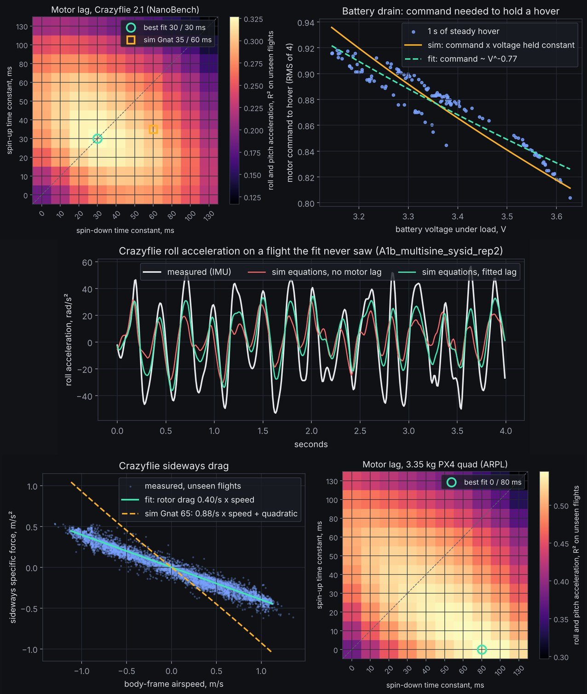
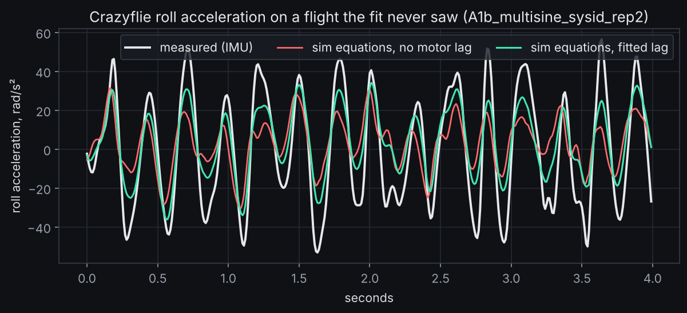
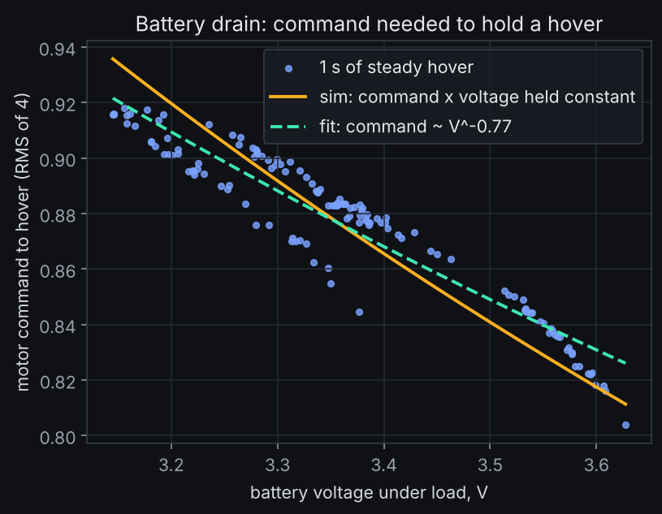
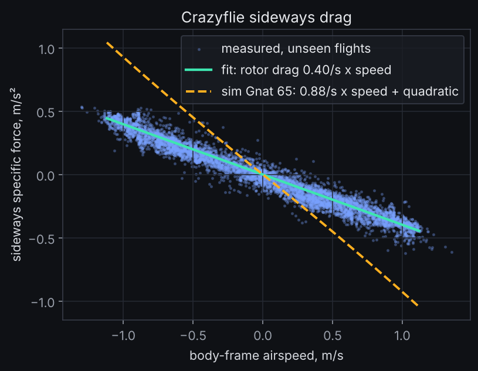

# Real-flight check: the quad model against public flight logs

This tests the motor and airframe equations in `src/sim/quad.ts` against two public datasets of real quadrotors flying. [PHYSICS-CHECK.md](PHYSICS-CHECK.md) checked the airframe numbers against thrust-stand tables; this check asks whether the equations themselves explain what a real quad does in the air. Nothing in the sim was changed as a result. The findings at the end are for a later decision.

To reproduce: `tools/realflight/fetch.sh` fetches both datasets at the pinned commits (about 550 MB), then `python tools/realflight/check.py --data .realflight-data --out docs/realflight` writes `docs/realflight/results.json` and the figures. The Python packages are in `tools/realflight/requirements.txt`.

## The datasets

| Dataset | Vehicle | What it logs | License | Commit |
| --- | --- | --- | --- | --- |
| [NanoBench](https://github.com/syediu/nanobench-iros2026) | Crazyflie 2.1, 40.85 g (27 g stock plus markers and the charging deck), brushed motors, 1S | Motion capture pose, IMU, the PWM actually applied to each motor, battery voltage; 100 Hz | BSD-3-Clause | `934a1ab` |
| [ARPL data-driven system identification](https://github.com/arplaboratory/data-driven-system-identification) | 3.35 kg PX4 quadrotor, 6S | Four ULogs: IMU, angular velocity and its derivative, motor commands. No battery voltage | MIT | `2d267dd` |

Neither vehicle is one of the sim's airframes. The nearest is the Gnat 65 (a 27 g, 1S ducted whoop) for the Crazyflie; nothing in the sim is close to a 3.35 kg quad. So the check fits each equation's constants to the vehicle and asks whether the equation's shape explains the data, scored on flights or stretches of flight the fit never saw. Where a fitted constant can be set next to a sim constant, it is.

How the data was split, so the scores are on unseen data:

- **Crazyflie, motors and rotation:** the fast multisine, trefoil, Lissajous, figure-eight and star flights. Odd repetitions fit, even repetitions score.
- **Crazyflie, battery:** the two battery-drain hovers.
- **Crazyflie, drag:** circle, oval, figure-eight, star and Lissajous flights at medium and fast speed, odd repetitions fit, even repetitions score.
- **ARPL:** every log cut into alternating 2 s blocks, even blocks fit and odd blocks score, with 0.1 s dropped at each block edge. The logs are mostly hover, so only stretches where the four motor commands differ from each other more than usual are used. That choice looks at the commands, not at the response being predicted.

Three Crazyflie flights were dropped before any fit, because their logs cannot be right: `B9_trefoil_fast_rep2` records a motor command 51.75 times full scale, `B9_trefoil_fast_rep3` 1.14 times and `B2_circle_medium_rep3` 6.92 times. The motor command is a 16-bit value, so anything past full scale is a bad record. `results.json` lists them under `dropped`.

Both sides of every comparison go through the same filters. The prediction gets the same low-pass filters the flight controller applies to its own IMU (Crazyflie accelerometer 30 Hz; PX4 `IMU_GYRO_CUTOFF` 40 Hz and `IMU_ACCEL_CUTOFF` 30 Hz, read from each log), and measured angular acceleration is the smoothed derivative of the gyro.

## Summary

| Claim in `quad.ts` | Crazyflie | ARPL | Verdict |
| --- | --- | --- | --- |
| Rotor speed lags its command | No lag explains 19% of roll and pitch acceleration on unseen flights; a 30 ms lag explains 33% | No lag 38%; 30 ms lag 53% | **Holds.** About 30 ms fits both vehicles. |
| Spinning down is slower than spinning up | Best fit 30 ms up and 30 ms down; the sim's 35 / 60 ms scores 0.03 lower | Best fit 0 ms up, 80 ms down, but symmetric 30 ms is within 0.011 of it | **Not shown.** Neither dataset supports the sim's slower spin-down. |
| Rotor speed goes with command times voltage | Leaving voltage out makes thrust far worse than a constant (R² −5.6); with it, R² 0.43 | No voltage logged | **Holds.** The hover test puts the exponent at 0.77 and the joint fit at 1.1; the sim's 1 sits between them. |
| Thrust goes with rotor speed squared | Fits best with speed to the power 1.3 (R² 0.64 against 0.43 for squared) | The whole command-to-thrust chain fits best at the power 3.5 (R² 0.71 against 0.59 at 2) | **Softer than squared on the Crazyflie,** which flies near full throttle. ARPL measures the ESC as much as the propeller. |
| Yaw from rotor drag torque plus spin-up reaction | R² 0.19 with the spin-up term, 0.03 without; signs disagree | R² 0.15 with the spin-up term, 0.07 without; signs disagree | **Not testable here.** These flights barely yaw. |
| Sideways drag is mostly rotor drag, linear in airspeed | Linear rotor drag R² 0.94; quadratic airframe drag 0.90 | Not tested (no airspeed) | **Holds** at these speeds. The Gnat's drag is about twice the Crazyflie's. |

## Motor lag

The sim moves each rotor's speed toward its target through a first-order lag with one time constant spinning up (`tauUp`) and another spinning down (`tauDown`). The check predicts roll and pitch acceleration from the four lagged rotor speeds (thrust per motor as a fitted constant times speed squared, with the mixing left to the fit) and scores the prediction on unseen flights for every pair of time constants from 0 to 130 ms.

| Vehicle | No lag | Best fit | Best symmetric | Sim Gnat 65 (35 / 60 ms) |
| --- | --- | --- | --- | --- |
| Crazyflie | R² 0.185 | 30 ms up, 30 ms down: 0.327 | 30 ms: 0.327 | 0.299 |
| ARPL | R² 0.379 | 0 ms up, 80 ms down: 0.545 | 30 ms: 0.534 | — |

- **The lag is real and matters.** On both vehicles it adds 14 to 17 points of explained variance, nearly doubling it on the Crazyflie, and the figure above shows why: without it the predicted roll acceleration leads the measurement.
- **About 30 ms fits both.** The Crazyflie's best fit is symmetric 30 ms. On ARPL the surface is a broad ridge, and a symmetric 30 ms sits within 0.011 of its best point.
- **The asymmetry is not supported.** The sim's Gnat spins down almost twice as slowly as it spins up. The Crazyflie's best point sits on the diagonal and its ridge runs along it. ARPL's best point is asymmetric the sim's way but with a zero spin-up lag, which is not physical and is within noise of the symmetric fit.
- **What the fitted lag includes.** Any timing offset between the logged motor command and the IMU sample adds to it, and so does the time the motor takes to respond to a command. So it is an upper bound on rotor spin-up time, not a measurement of it. The Crazyflie logs at 100 Hz, so its grid is only one sample wide near the best point.
- **Why R² stays low.** The figure shows the fitted model following every swing but reaching only about two thirds of the peaks. Angular acceleration is a differentiated gyro signal on a vibrating airframe, so much of it is noise no rigid-body model can explain. The scores compare models with each other; they are not a ceiling.

## Battery voltage and thrust

The sim sets each rotor's target speed to command times maximum rotor speed times battery voltage over a reference voltage, and thrust to a constant times speed squared. The Crazyflie logs the PWM actually applied to each motor (after the firmware's own battery compensation) and the battery voltage, so both parts can be tested against vertical specific force on unseen flights.

| Model | Voltage exponent | Speed exponent | R² | RMS error |
| --- | --- | --- | --- | --- |
| Sim structure | 1.0 | 2.0 | 0.427 | 3.1% of hover thrust |
| Voltage ignored | 0 | 2.0 | −5.59 | 10.5% |
| Best fit on the grid | 1.1 | 1.3 | 0.640 | 2.5% |

A separate test needs no thrust model at all. Over the two battery-drain flights, 131 one-second stretches of steady hover between 3.15 and 3.63 V give the command needed to hold the quad up at each voltage. If rotor speed goes with command times voltage, that command goes as 1/V. It goes as V to the power −0.77.

- **Voltage matters about as much as the sim says.** Dropping it from the model is the single worst change in the table. The two tests bracket the sim's exponent of 1: the hover test says 0.77 (as the pack runs down, the real motors lose a little less than the sim's do) and the joint fit says 1.1, where it trades off against the speed exponent.
- **Thrust is softer than speed squared on this vehicle.** The caveat is large: this Crazyflie carries 14 g over stock, so it needs 80 to 92% of full command just to hover, depending on the battery, and its dynamic flights run close to the top of the range. Brushed motors near full duty are not in the regime the sim's square law was written for, and the voltage and speed exponents trade off against each other on the grid. A lighter quad, or one with RPM telemetry, would settle it.
- **ARPL cannot test this.** It logs no voltage, and PX4 sends a normalised command to the ESC, whose own throttle curve sits between command and rotor speed (`THR_MDL_FAC` is 0 in these logs). Fitted against angular acceleration, the command-to-thrust chain goes best as command to the power 3.5 (R² 0.71 on unseen blocks, against 0.59 for the sim's square law). That exponent describes the ESC's throttle mapping and the propeller together, so it says nothing about the square law on its own.

## Yaw

The sim's yaw comes from each rotor's drag torque plus the reaction to its rotor spinning up or down, with both on the same sign per rotor.

| Vehicle | R², drag torque only | R², with spin-up reaction | Per-rotor signs match the sim |
| --- | --- | --- | --- |
| Crazyflie | 0.03 | 0.19 | No |
| ARPL | 0.07 | 0.15 | No |

Neither dataset tests the yaw model. The flights hold heading, so yaw acceleration is small and mostly noise; the fitted per-rotor coefficients do not even agree in sign with a rotor's spin direction. The spin-up term helps on both, which is the one weak hint in the data, and it is not enough to stand on.

## Sideways drag

The sim slows a moving quad with a rotor term (each rotor pushes back with a force proportional to its speed times airspeed) and an airframe term (proportional to airspeed squared). On the Crazyflie, sideways specific force in the body frame was fitted against body-frame velocity from motion capture, on medium and fast flights, and scored on unseen ones. Median airspeed was 0.55 m/s and the 99th percentile 1.1 m/s.

| Model | R² on unseen flights | Fitted drag at hover |
| --- | --- | --- |
| Rotor drag, linear | 0.945 | 0.40 per second |
| Airframe drag, quadratic | 0.903 | — |
| Both | 0.945 | linear 0.37 per second, quadratic 0.03 per metre |
| Sim Gnat 65 | — | linear 0.88 per second, quadratic 0.05 per metre |

- **Rotor drag dominates at these speeds,** as the sim assumes. Adding a quadratic term does not help on unseen flights, and its fitted coefficient comes out small (0.03 per metre against the Gnat's 0.05).
- **The Gnat decelerates about twice as hard.** At hover the sim's Gnat loses 0.88 m/s of speed per second for each m/s of airspeed; the Crazyflie loses 0.40. The Gnat is a ducted whoop and ducts add drag, so this is a pointer, not a contradiction.
- **Speeds were low.** Under 1.1 m/s, a quadratic term is small for any plausible drag area, so this test says little about drag at FPV speeds.

## Checks on the data itself

- **Gyro units.** The Crazyflie's IMU roll and pitch rates against rates differentiated from motion capture: slope 0.85, correlation 0.94. The slope below 1 comes from smoothing the motion capture; it rules out a units mix-up.
- **Impossible records.** Three Crazyflie flights log motor commands past full scale and are dropped (see the split above). Before this check caught them, one of them, a trefoil whose log also reaches 14 g, dragged every Crazyflie fit below zero.
- **Mass.** NanoBench's README gives the flying mass as 40.85 g; ARPL's notebook gives 2.3 kg plus a 1.05 kg battery. Neither test depends on mass except through the fitted constants.

## What this suggests, for a later decision

1. Keep the motor lag near 30 ms for the small airframes and consider making spin-up and spin-down equal, since neither dataset shows the asymmetry.
2. Leave the voltage exponent at 1: the two Crazyflie tests bracket it.
3. Look again at the Gnat's rotor drag, which is about twice the Crazyflie's for a quad of similar size, if its ducts are not meant to account for all of it.
4. Yaw needs a dataset with deliberate yaw manoeuvres and RPM telemetry before anything can be said.

## Attribution

- NanoBench: Syed Izzat Ullah and Jose Baca, "NanoBench: A Multi-Task Benchmark Dataset for Nano-Quadrotor System Identification, Control, and State Estimation", arXiv 2603.09908, 2026. Data at [github.com/syediu/nanobench-iros2026](https://github.com/syediu/nanobench-iros2026), BSD-3-Clause.
- "Data-Driven System Identification of Quadrotors Subject to Motor Delays", [github.com/arplaboratory/data-driven-system-identification](https://github.com/arplaboratory/data-driven-system-identification), MIT License, copyright 2024 Jonas Eschmann.

The datasets are fetched by `tools/realflight/fetch.sh` and are not stored in this repository.
